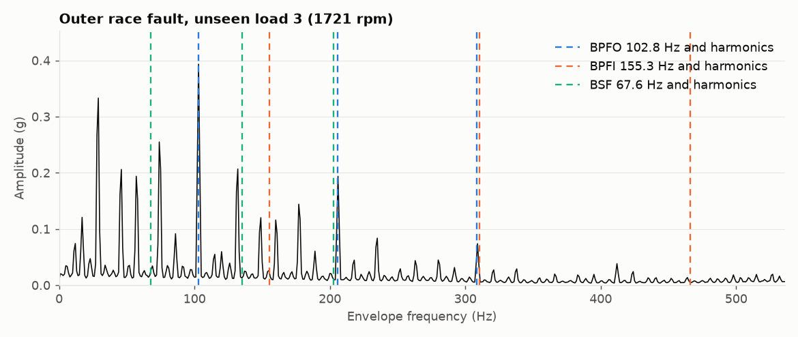
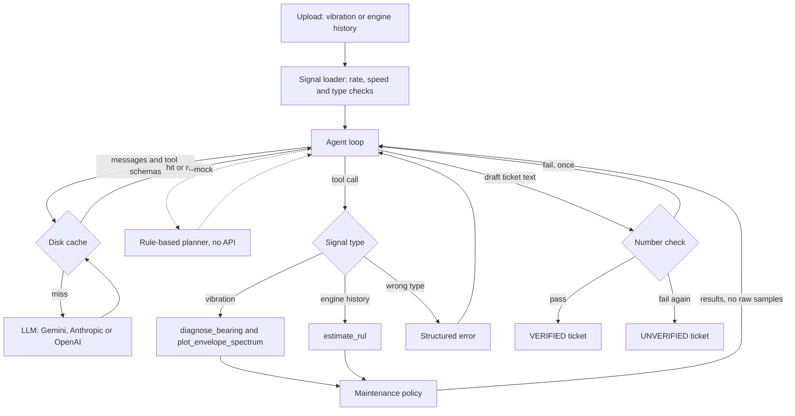
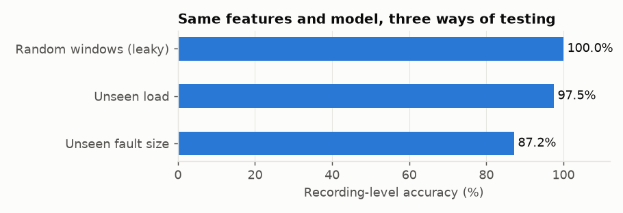
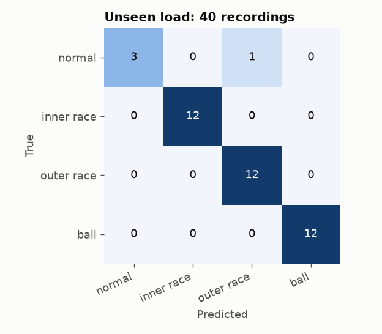
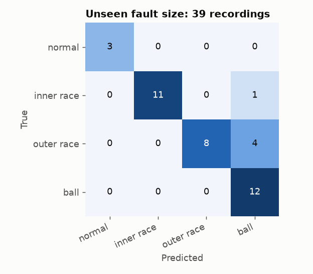
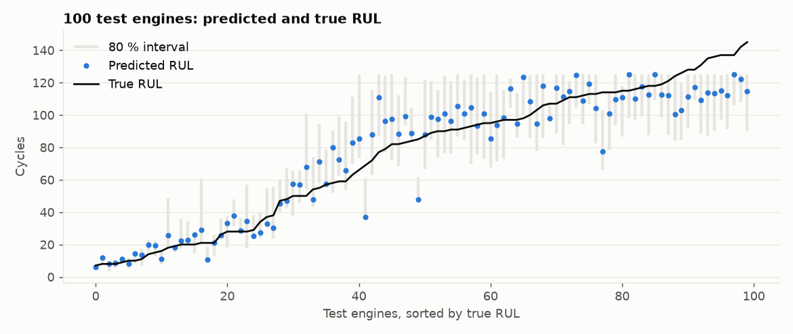

# Predictive Maintenance Agent

Turns a machine signal into a maintenance ticket: what is wrong, how sure we are, what to do, and by when. Physics and machine learning produce the numbers. An LLM agent picks the tools and writes the explanation, and code checks that every number it writes came from a tool.



## Problem

Unplanned failures are expensive, and vibration analysis needs a specialist to read it. Two things go wrong when this is automated:

- **Scores look better than they are.** Bearing datasets are easy to leak. A random split on this data scores 100%.
- **Language models invent numbers.** A made-up deadline on a maintenance ticket is worse than no ticket.

This project is built around those two risks.

## Approach

**Part A: fault diagnosis (CWRU bearings).** Classifies normal, inner race, outer race and ball faults from 1 s windows. Features are time domain (RMS, kurtosis, crest factor, skewness, peak-to-peak) and envelope spectrum (band-pass, Hilbert envelope, then peak levels at BPFO, BPFI and BSF computed from bearing geometry and shaft speed). The model is gradient boosting, tested on operating loads it has never seen.

**Part B: remaining useful life (NASA C-MAPSS FD001).** Gradient boosting on trailing 30-cycle sensor statistics, with an 80% prediction interval from quantile models. It is compared with an age-only baseline and a ridge model, using RMSE and the NASA scoring function.

**Part C: ticket agent.** A tool-calling loop with `diagnose_bearing`, `estimate_rul` and `plot_envelope_spectrum`. Gemini is the default, Anthropic and OpenAI are configurable, and every reply is cached to disk. The work is divided so that the model has little room to do damage:

| Written by tools and code | Written by the LLM |
|---|---|
| Asset, confidence, urgency, action window, RUL line, evidence, plots | Finding and recommended action, in plain words |

Each number in the LLM's text, including percentages and spelled-out numbers, is then matched against the tool results. Deadlines are held to a stricter rule: they must equal the policy window, so "3 days" fails even if a 3 appears somewhere in a tool result. A failed draft gets one retry that names the offending numbers. After that, the ticket is stamped **UNVERIFIED**.

**RUL is deliberately not estimated for bearings.** CWRU has no run-to-failure history and C-MAPSS is a different machine, so a bearing RUL would be made up. Asked for one, the tool refuses and the ticket says it is not available.

### Dataset traps found and handled

Each was confirmed on the real files, and `tests/test_data_cwru.py` covers them.

- **Normal recordings are 48 kHz, not 12 kHz.** Read at 48 kHz, their shaft line follows speed to within 0.03 Hz across all four loads. Read at 12 kHz, it stays at 30.00 Hz at every speed, because that line is really the fixed 120 Hz mains component.
- **`99.mat` also contains a byte-for-byte copy of the signal in `98.mat`.** A loader taking the first drive-end variable would leak a load 1 recording into load 2.
- **`98.mat` and `99.mat` have no RPM value.** Nominal speed is used, and it agrees with the measured shaft line.

## Architecture



## Results

All figures come from running this code. `train.py` and `scripts/sanity_checks.py` regenerate Parts A and B, and two training runs gave byte-identical metrics.

### Part A: fault diagnosis

One set of features and one model, tested three ways. How you test matters more than anything else here.



| Test | Recordings | Window accuracy | Recording accuracy | Recording macro-F1 |
|---|---|---|---|---|
| Random windows (leaky, shown as a warning only) | 40 | 99.6% | 100% | 1.000 |
| **Unseen load (headline, 4 folds)** | 40 | 96.3% | **97.5%** | 0.954 |
| Shipped model on unseen load 3 | 10 | 94.7% | 100% | 1.000 |
| **Unseen fault size (3 folds)** | 39 | 85.0% | **87.2%** | 0.896 |

The demodulation band is chosen inside each fold, using training data only.

| Unseen load | Unseen fault size |
|---|---|
|  |  |

- **Why the load split is a gentle test.** CWRU uses the same physical bearing at all four loads, and speed changes by only about 4%. The model has already seen each defect, so 97.5% says little about a new bearing.
- **Unseen fault size is the harder test, and the more realistic one.** By fold: 0.007 in 100%, 0.014 in 61.5%, 0.021 in 100%. All five errors are in the 0.014 in fold, and all five wrongly say ball. The score also depends on the band: forcing one band on every fold gives 76.9% to 89.7%, so treat 87.2% as a rough figure.
- **The one load-split error is a false alarm.** The healthy load 0 recording was called outer race. Its RMS (0.072 g) sits just above the other healthy recordings (0.057 to 0.062 g), and setting only that feature to a typical value flips all 9 windows to normal. Three healthy recordings are too few to define "healthy".

**Does the envelope help?** Yes, but only in combination, and not in the way the textbook suggests.

| Features (unseen load) | Recording accuracy | Macro-F1 |
|---|---|---|
| Time domain only | 92.5% | 0.913 |
| Envelope only | 75.0% | 0.610 |
| Both | 97.5% | 0.954 |

Ball faults are the reason. On training loads their BSF level averages 5.8 dB above the floor, while healthy recordings reach 7.6 dB by chance. So the envelope cannot confirm a ball fault on this rig, and ball calls cannot reach high confidence.

**Can the confidence label be trusted?** It is a fixed rule: high needs a confident classifier *and* envelope agreement. It is more useful than the raw probability, which was 0.995 on the false alarm.

| Confidence | Unseen load: correct | Unseen fault size: correct |
|---|---|---|
| High | 23 of 23 | 15 of 15 |
| Medium | 15 of 16 | 19 of 23 |
| Low | 1 of 1 | 0 of 1 |

The false alarm landed in medium, which leads to a re-measure rather than a bearing change. Raw probabilities degrade away from the training conditions: calibration error (ECE) rises from 0.031 on unseen load to 0.134 on unseen fault size. These counts are small, and the 10 dB evidence threshold was set from loads 0 to 2, which also appear as test folds in the load split.

### Part B: remaining useful life

100 NASA test engines, scored at each engine's last cycle.

| Model | RMSE vs true RUL | RMSE vs capped RUL | NASA score (lower is better) |
|---|---|---|---|
| Fleet-life baseline (age only) | 36.72 | 36.51 | 7,779 |
| Fleet-life baseline, capped at 125 | 32.96 | 32.23 | 5,421 |
| Ridge (sensors) | 15.95 | 14.58 | 404 |
| **Gradient boosting (sensors)** | **13.27** | **11.97** | **245** |

Papers differ on whether test truth is capped, so both are shown. The 95% bootstrap interval on 13.27 is 11.2 to 15.3. The 80% interval covered 79% of engines (against capped truth), with a mean width of 28.7 cycles.



**Checks on that score.** It was close enough to published deep learning results to deserve suspicion. No test row matches a training row, and giving each engine another engine's labels raises cross-validated RMSE from 13.3 to 37.0, so the model really is reading the sensors.

**Where it stops working.** NASA's test set has few healthy engines (11% above 125 cycles, maximum 145). Cutting held-out training engines at uniformly random ages (500 cuts) shows the full picture:

| True RUL | Cuts | RMSE | Mean prediction |
|---|---|---|---|
| 0 to 50 | 156 | 8.3 | 28 |
| 50 to 125 | 221 | 17.2 | 90 |
| 125 to 145 | 41 | 22.8 | 115 |
| Above 145 | 82 | 70.5 | 117 |

Overall RMSE on those cuts is 31.8 against true RUL, or 13.6 against capped RUL. The model is accurate near failure, where it matters, and can only say "healthy" further out, by design of the capped label. Tickets therefore report "at least N cycles" above 110 instead of a false point value.

The confidence label for RUL separates accuracy only weakly (capped RMSE 10.5 high, 12.9 medium, 12.2 low), so treat it as a rough guide. The interval itself is the better signal.

### Part C: agent

8 cases, using `gemini-3.1-flash-lite`. Real bearing cases are load 3 recordings the shipped model has never seen.

| Case | Right tools | Diagnosis | Correct | Number check | Confidence | Urgency | Special check |
|---|---|---|---|---|---|---|---|
| Normal, load 3 | yes | normal | yes | VERIFIED | high | routine | |
| Inner race 0.014 in, load 3 | yes | inner race | yes | VERIFIED | high | high | |
| Outer race 0.021 in, load 3 | yes | outer race | yes | VERIFIED | high | high | |
| Ball 0.007 in, load 3 | yes | ball | yes | VERIFIED | medium | medium | |
| Ball 0.021 in, load 3 | yes | ball | yes | VERIFIED | medium | medium | |
| NASA test engine 34 | yes | RUL 6 cycles | n/a | VERIFIED | high | critical | |
| Trap: RUL asked of a bearing | yes | outer race | yes | VERIFIED | high | high | RUL refused: yes |
| Synthetic signal at 900 rpm | yes | inner race | n/a | VERIFIED | low | low | Flagged: yes |

The check caught 40 of 40 invented claims added to clean tickets, with no false alarms on the tickets themselves.

**How to read this honestly:**

- **The live model invented no numbers in this run, so the check was barely exercised live.** Its findings are short and quote few numbers. The 40 of 40 result covers five fabrications I wrote myself, repeated across eight tickets, so it shows the check works on those patterns, not that it is unbeatable.
- **The first live run took 20 paid calls and 4 retries, all caused by a bug in the checker.** The model wrote `outer_race`, and the check only accepted `outer race`. After the fix, the table above was replayed from cached replies with a budget of zero paid calls, so it shows 0 retries.
- **Eight cases is a smoke test, not a benchmark** (`results/eval_live.md`, `results/eval_mock.md`).
- **The text is correct but plain.** The evidence section of each ticket carries most of the detail. See the [example ticket](results/example_ticket.md).

**Model choice.** Gemini 2.5 Flash-Lite is the cheapest on Google's price list but returned a 404 ("no longer available to new users"), so 3.1 Flash-Lite is the default. Set `LLM_MODEL` to change it.

## How to run

Python 3.12. No API key or dataset is needed for the first block.

```bash
python -m venv .venv
.venv/Scripts/activate            # Linux or macOS: source .venv/bin/activate
pip install -r requirements.txt

python cli.py --mock --file samples/synthetic_outer_race.csv
streamlit run app.py              # mock mode is on by default
pytest
```

Reproduce everything from the real data (146 MB, a few minutes on a laptop CPU, no API calls):

```bash
python scripts/download_data.py
python train.py
python scripts/sanity_checks.py
python evaluate.py --mock
```

Use a live model:

```bash
cp .env.example .env              # then add your key
python cli.py --file data/raw/cwru/237.mat --asset "Pump P-7"
python evaluate.py --live --max-calls 40   # hard budget, cached replies are free
```

The repo contains no raw data. Files in `samples/` are synthetic and generated by `scripts/make_samples.py`.

## Limitations

- **One rig, seeded faults.** CWRU defects were machined into bearings, not grown through wear. Expect lower accuracy on real machines, and the model should be retrained before use on another machine.
- **Very little healthy data.** There are four healthy recordings, and the false alarm above comes directly from that. They were also resampled, so an anti-alias filter touched only that class, and normal-versus-fault separation may partly reflect recording differences.
- **Closed set.** The classifier must choose one of four classes. It cannot say "unknown fault", and it does not handle combined faults, gear problems or looseness. Out-of-range checks reduce this risk but do not remove it: at 900 rpm it still said inner race, though with a warning and low confidence.
- **No bearing severity or life estimate.** It reports fault type, not size or time to failure.
- **Ball faults are weak.** Their calls rest on the classifier alone, since the envelope cannot confirm them here.
- **Small test sets.** 40 recordings and 100 engines. One recording moves accuracy by 2.5 points.
- **C-MAPSS is simulated,** with one operating condition and one failure mode. Real fleets have changing conditions, repairs and missing data. Beyond about 125 cycles, the model only says "healthy".
- **Policy values are placeholders.** The urgency tiers and action windows in `pm_agent/policy.py` are demo values. A reliability engineer should set them from failure costs and spares lead times.
- **The number check proves origin, not truth.** It shows a number came from a tool, not that the tool is right, and it does not judge the reasoning in the prose. A number used in the wrong context can also pass.
- **A person should approve interventions.** This supports an engineer's decision and does not replace it.

## Data sources

- [Case Western Reserve University Bearing Data Center](https://engineering.case.edu/bearingdatacenter).
- A. Saxena, K. Goebel, D. Simon, N. Eklund, "Damage Propagation Modeling for Aircraft Engine Run-to-Failure Simulation", PHM 2008. NASA Prognostics Data Repository.
