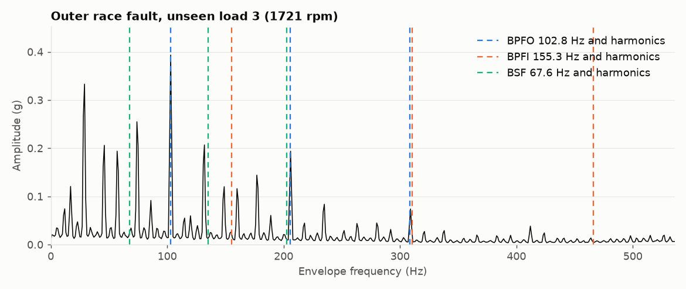

# Maintenance ticket PM-D095E51D

| Field | Value |
|---|---|
| Asset | Eval outer_race_021_load3 (bearing, SKF 6205-2RS JEM) |
| Urgency | **high** |
| Act within | 7 days |
| Confidence | high |
| Remaining useful life | Not available for this asset type (bearing recordings have no run-to-failure history). |
| Number check | VERIFIED |

## Finding

The vibration analysis indicates an outer_race fault with high confidence. The envelope spectrum analysis supports this diagnosis, showing significant evidence at the BPFO frequency.

## Recommended action

Plan a bearing inspection within 7 days as per the high urgency maintenance policy.

## Evidence

- Classifier: outer_race, mean probability 0.998, agreement across 19 windows 1.0.
- Time domain: RMS 0.555 g, kurtosis 19.52, crest factor 10.26.
- Envelope check against the classifier: supports (a line counts as real at 10.0 dB above the floor).
- BPFO at 102.8 Hz: mean 23.4 dB above the floor.
- BPFI at 155.3 Hz: mean 10.2 dB above the floor.
- BSF at 67.6 Hz: mean 12.6 dB above the floor.

*Tool outputs are model estimates from public benchmark data. An engineer should confirm before any intervention.*
